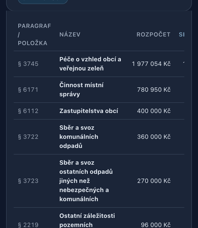
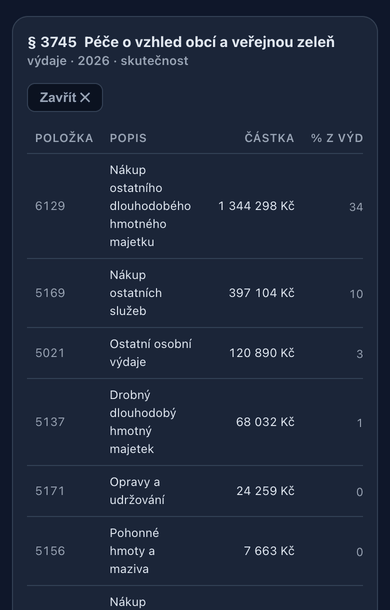
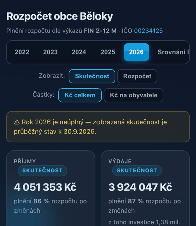
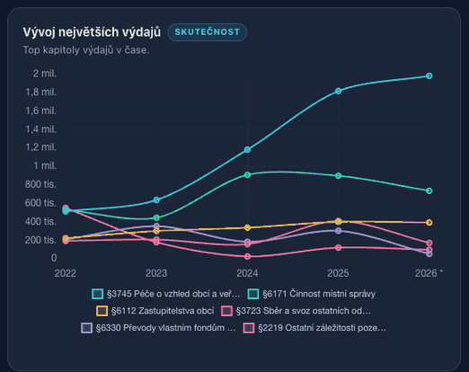
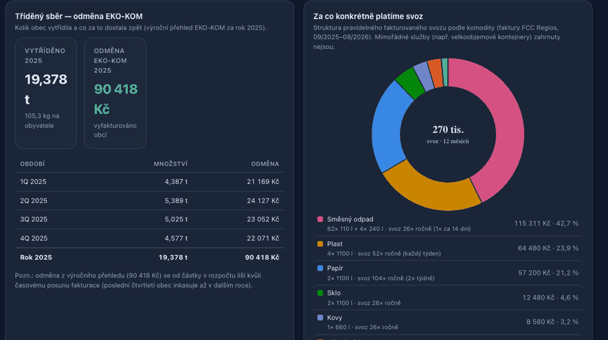

# UI review — October 2026

**Method.** Playwright with Chrome at 1280×900 (desktop) and 390×844 (mobile, 2× DPR). All public views were
loaded: year 2026 and 2025, budget mode, per-capita mode, comparison of years, analytics and waste. The
review also opened a drill-down, walked the page with the keyboard (45 × Tab) and ran axe-core 4.10. Chart
palettes went through the dataviz validator (OKLab ΔE, CVD simulation) against the panel surface `#1c2537`.
Real traffic for context: about 60 app loads from about 40 IP addresses in 30 days. The main external
referrer is LinkedIn.

## What works

* Clear KPI row; the partial-year warning and the "skutečnost / rozpočet" mode are always visible.
* Budget-vs-actual bullet bars with the approved-budget tick are a good, compact form.
* No horizontal page overflow on the public site, no console errors, first render under 1 s locally.
* The waste tab uses a validated palette, surface gaps and direct labels. It is the best-designed part
  of the site and the pattern to copy elsewhere.

## Findings

### High

1. **On mobile the active column is off-screen.** In the detailed tables, the analytics table and the
   drill-down, the "Skutečnost" column sits right of "Rozpočet". At 390 px it is cut off behind a
   horizontal scroll that nothing announces.
    
2. **Drill-down is mouse-only.** 56 clickable elements are not keyboard-focusable: legend rows,
   budget-vs-actual rows and expandable table rows. Tab lands on the legend's scroll container instead
   (axe: `scrollable-region-focusable`, serious). Keyboard and screen-reader users cannot open any detail.
3. **Navigation on mobile hides half of the site.** One tab strip mixes years with views. At 390 px only
   the years and half of "Srovnání let" are visible; "Analýza" and "Odpady" are off-screen with no scroll
   affordance.
   
4. **Chart colors and lines.**
   * The overview palette is pastel and outside the lightness band.
   * The income donut fails colour-blind separation: aqua vs pink is ΔE 5.0 for deutan.
   * The palette is inconsistent with the waste tab.
   * Smoothed lines (`tension: .3`) draw values that do not exist between years and overshoot.
   * The "biggest expenses" trend includes §6330 internal transfers, which is not an expense for a
     resident.
   

### Medium

5. **View state is not written to the URL.** Clicking a year or a mode leaves `/` unchanged, so a view
   cannot be shared. This matters because visitors arrive through shared links.
6. **No social preview.** There is no meta description, `og:title` or `og:image`, so a link on LinkedIn
   shows a bare URL.
7. **Canvas text renders in a serif font.** This affects the donut centre values and the data labels in
   the waste charts, because custom plugins set `ctx.font` without a family.
   
8. **The mode chip repeats.** "SKUTEČNOST" appears up to six times per screen (KPI labels, panel titles,
   table summaries). One indicator next to the toggle plus the highlighted column is enough.
9. **Long mobile page (5.4k px).** Both detailed tables are open by default, paragraph names wrap to 4–5
   lines and the code column wraps as "§ / 3745".
10. **Bars are hard to read on mobile.** Budget-vs-actual rows share one scale with the revenue and
    expenditure totals, so paragraph bars are a few pixels wide.
11. **Small text and small targets.** 69 text elements are under 12 px (chips 10.5 px, percentages
    11.5 px). Toggles are 28 px high and legend rows 30 px, below a comfortable 44 px touch target.
12. **Waste stat tiles are too narrow.** Values wrap ("19,378 / t", "90 418 / Kč"). Three decimals of
    tonnes are noise; "19,4 t" reads better.
13. **Structure for assistive tech is missing.** There is no `<main>`/`<nav>` landmark (axe:
    `landmark-one-main`, `region`), canvases have no `role="img"`/`aria-label`, and there is no skip link.
14. **The comparison view shows the latest year's KPIs**, which are out of context there. The footer's
    "sestaveno k" date does not follow the selected year.
15. **Dates are formatted inconsistently**: "30.9.2026" vs the Czech typographic "30. 9. 2026".

### Low

16. Dark theme only and no print stylesheet on the public page.
17. JSON is fetched with `cache: "no-store"`; `no-cache` would let the ETag return 304s.
18. The header layout jumps when switching to the waste tab, because the toggles are hidden.
19. There is no plain-language help: how to read the page, what a paragraph or item is, contact.

### Internal dashboard and reports

20. **Three different year-end forecasts.** The dashboard, the audit report and the economic analysis
    use different methods and different as-of months. Dashboard alerts still compute "% of year" from
    month 8 although the latest statement is 9/2026. One forecast module with a visible as-of date is
    needed.
21. **The audit report overflows on mobile.** The page is 505 px wide on a 390 px screen, because grid
    children lack `min-width: 0`.
22. **Dashboard tabs wrap into four rows on mobile**, and links to external reports are styled like tabs.
23. **Reports are very long on mobile** (up to 35k px). A sticky mini table of contents or a back-to-top
    link would help.

## Fixes, roughly in order of value per effort

| # | Change | Where |
|---|---|---|
| 1 | Put the active column first on mobile (or hide "Rozpočet" in actual mode); sticky first column in wide tables | `fullTable`, `renderAnalyza`, `showDrill*`, CSS |
| 2 | Make legend rows, bar rows and expandable rows real buttons (`<button>` or `tabindex=0` + `role=button` + Enter/Space), `aria-expanded` on rows | `buildLegend`, `renderPlneni`, `fullTable` |
| 3 | Split navigation: view switch (Rok / Srovnání / Analýza / Odpady) and a year selector (segmented on desktop, `<select>` on mobile) | header markup, `init` |
| 4 | `history.replaceState` on every state change (year, view, mode, per capita, analytics filters) | `render` |
| 5 | Adopt the validated categorical slots from the waste tab (`#3987e5 #d95926 #199e70 #c98500 #d55181 #008300 #9085e9`) in fixed order; `tension: 0`; drop §6330 from trends | `PALETTE`, `PRIJEM_CATS`, `renderComparison` |
| 6 | `Chart.defaults.font.family` = system stack and use it in every custom plugin | top of `app.js` |
| 7 | Meta description, Open Graph tags and a static 1200×630 preview image | `index.html` |
| 8 | Remove the mode chips from KPI labels and panel titles | `renderKpis`, markup |
| 9 | Close detailed tables by default below 560 px; `white-space: nowrap` on codes | `init`, CSS |
| 10 | Landmarks, skip link, `role="img"` + summary `aria-label` on canvases | markup, chart helpers |
| 11 | Waste tiles on `repeat(auto-fit, minmax(150px, 1fr))`; tonnes with one decimal | `renderOdpady`, CSS |
| 12 | Internal: one forecast module and as-of month taken from the data; `.grid2 > * { min-width: 0 }` in the reports | `interni/app.js`, report CSS |
